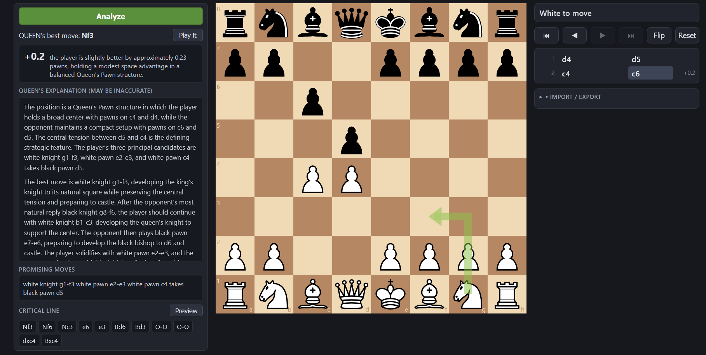

# Queenside

An unofficial chess analysis web app for **Queen**, a chess language model that
plays at Grandmaster level and explains its moves. Lichess-style board UI
(react-chessboard, chess.js) backed by a FastAPI server that wraps the
`queen_pawn-8` checkpoint (SmolLM3-3B + a Leela Chess Zero BT5 encoder) via
vLLM. A deterministic mock engine lets the whole app run and be tested without
a GPU.



> **Not affiliated with or endorsed by the Queen authors, Princeton University,
> or Lichess.** This project contains none of the Queen training or model code;
> it downloads the released weights from Hugging Face. See
> [Credits and licenses](#credits-and-licenses).

## Layout

| Path | What |
|---|---|
| `backend/` | FastAPI app (`backend.app.main:app`), engines in `backend/app/engine/` (`mock.py`, `queen.py`), tests in `backend/tests/` |
| `frontend/` | Vite + React app (react-chessboard, chess.js); built output in `frontend/dist` (served by the backend) |
| `queen_pawn-8/` | Queen model weights + inference code (~8.4 GiB). **Not in git** — fetched from [huggingface.co/princeton-nlp/queen_pawn-8](https://huggingface.co/princeton-nlp/queen_pawn-8) by `./setup.sh`. Required only for `ENGINE=queen` |
| `requirements.txt` | The 7 direct backend dependencies (pinned) — what to install |
| `constraints.txt` | Full pin set of the tested environment — use only as `-c` |
| `setup.sh` | One-shot setup: venv + pinned deps + model download (verified against `queen_pawn-8/release.json`) + frontend build |
| `docs/licenses.txt` | Captured `pip-licenses` / `license-checker` output |
| `DEPENDENCIES.md` | Third-party components and license terms |

## Setup

From a fresh clone:

```bash
./setup.sh           # venv + pinned deps + downloads & checksums queen_pawn-8 (~8.4 GiB) + frontend build
./setup.sh --no-model  # everything except the model (mock engine still runs without a GPU)
```

The model is downloaded from
[huggingface.co/princeton-nlp/queen_pawn-8](https://huggingface.co/princeton-nlp/queen_pawn-8)
(via `git clone` + `rm -rf .git` when git-lfs is present, otherwise `hf`), and
every file is verified against `queen_pawn-8/release.json` (sha256 + size).

`setup.sh` leaves you exactly in the state of the two manual sections below
(kept for reference — it also re-verifies an existing model with
`--verify-model`, and re-fetches it with `--refresh-model`). If astral
[uv](https://astral.sh/uv) is installed, the script uses it for the Python
install (the same tool the model's own README uses; ~10–100x faster than
pip — a full fresh install took ~1 minute here vs. minutes with pip). Without
uv it transparently falls back to plain `venv` + pip (`--no-uv` forces that
path, as does the manual section below).

## Backend setup

Python **3.12.3** (do not deviate; the pins are tested for this version).

```bash
python3.12 -m venv .venv
.venv/bin/pip install -c constraints.txt -r requirements.txt
```

> **Do NOT** `pip install -r queen_pawn-8/requirements-inference.txt`. That file
> is a constraints file only and lists a `python-chess==1.999` stub alongside
> the real `chess` package; installing it directly can break the `chess` module.
> (It is what the working environment was built *with as `-c`*, already folded
> into our `constraints.txt` without the stub.)

## Frontend setup

```bash
cd frontend
npm ci
npm run build     # writes frontend/dist, which the backend serves at /
```

## Running

Both engines serve on port **6006**:

```bash
# No GPU needed, deterministic:
ENGINE=mock .venv/bin/uvicorn backend.app.main:app --host 0.0.0.0 --port 6006

# Real model (needs the model dir + enough free VRAM):
ENGINE=queen .venv/bin/uvicorn backend.app.main:app --host 0.0.0.0 --port 6006
```

Then open `http://localhost:6006/`. Until the engine finishes loading,
`/api/health` reports loading and `/api/analyze` returns 503; a second
concurrent analyze while one is running returns 429.

### Environment variables

| Var | Default | Meaning |
|---|---|---|
| `ENGINE` | `mock` | `mock` or `queen` |
| `QUEEN_MODEL_DIR` | `./queen_pawn-8` (relative to the process CWD — start the server from the repo root) | model directory |
| `QUEEN_GPU_UTIL` | `0.25` | vLLM `gpu_memory_utilization` (infer.py's 0.72 is NOT used) |
| `QUEEN_MAX_NUM_SEQS` | `1` | vLLM `max_num_seqs` |
| `MOCK_DELAY_MS` | `0` | mock: artificial analyze delay (ms) |
| `MOCK_LOAD_MS` | `0` | mock: artificial engine load time (ms) |

## Tests

```bash
# Backend (mock; the GPU tests are opt-in):
.venv/bin/pytest backend -m "not gpu"
ENGINE=queen .venv/bin/pytest backend -m gpu

# Frontend:
cd frontend && npm test
```

## Credits and licenses

Queenside is a front end for **Queen**, created by Adithya Bhaskar, Jeffrey
Cheng, and Danqi Chen (Princeton Language and Intelligence, Princeton
University). All model capability comes from their work.

- Paper: [Language Models that Play Chess and Explain Their Moves](https://arxiv.org/abs/2610.03695)
- Project page: https://queen-project.github.io/
- Code: https://github.com/queen-project/queen
- Weights used here: [princeton-nlp/queen_pawn-8](https://huggingface.co/princeton-nlp/queen_pawn-8)

If you use this app in research or write about results from it, please cite
the paper:

```bibtex
@misc{bhaskar2026queen,
  title         = {Language Models that Play Chess and Explain Their Moves},
  author        = {Bhaskar, Adithya and Cheng, Jeffrey and Chen, Danqi},
  year          = {2026},
  eprint        = {2610.03695},
  archivePrefix = {arXiv},
  primaryClass  = {cs.CL}
}
```

The Queen model weights are the work of their authors and are **not** covered by
this repository. They are downloaded from Hugging Face at runtime; Queenside
does not host or redistribute them. At the time of writing no license has been
published for the weights, so please do not redistribute them without the
authors' permission. They build on SmolLM3-3B and the Leela Chess Zero BT5
network, which have their own licenses. Third-party components and their terms
are listed in [DEPENDENCIES.md](DEPENDENCIES.md).